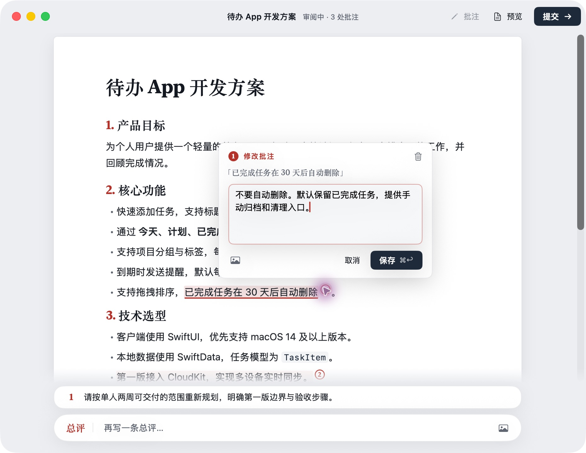
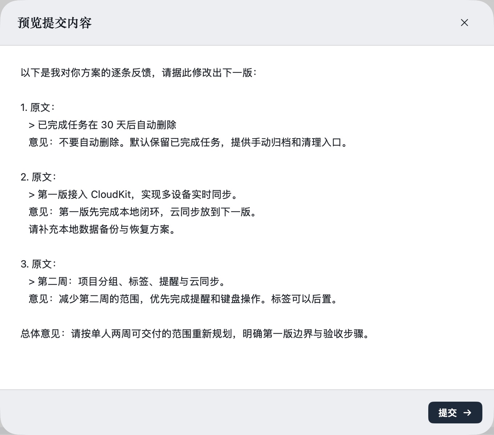

# Loop

**在 AI 的方案上直接批注，点一次提交，让 Agent 按你的意见继续改。**

不用来回复制原文，也不用解释“我说的是第三段的第二句”。选中哪里，意见就跟着哪里一起回到 Agent。

[下载 Mac 版](https://github.com/ChrisZou/loop/releases/latest) · [让 Agent 帮你安装](#让-agent-帮你安装) · [手机审阅](#在手机上审阅)

## 看看实际效果

Agent 写好方案，Loop 打开审阅窗口。选中一句话，写下你的修改意见；也可以贴一张截图，或在底部写总体意见。



点击「提交」，Agent 会同时收到**你选中的原文、对应的意见和总评**，据此修改下一版，再交给你审阅。

<details>
<summary>查看这轮审阅会交给 Agent 的反馈</summary>



</details>

比如这次审阅，你把“30 天后自动删除”改成“保留任务、手动归档”，要求推迟云同步，并缩小两周内的交付范围。Agent 收到的是每条意见对应的原文，可以逐条落实。

**Agent 写方案 → 你选字批注 → 提交反馈 → Agent 修改 → 再审一轮。**

除了方案，也可以用来审文章、需求、实施计划和研究结论。Mac 版支持截图批注、待办勾选，以及回看已提交的审阅记录。

## 让 Agent 帮你安装

在 **Mac 本机运行、能执行终端命令的 Agent** 中复制下面整段，例如 Claude Code、Codex 或 WorkBuddy。它会安装 App、`loop` 命令和 `loop-review` Skill，最后打开一份示例供你试用。

当前下载版需要 **macOS 14+、Apple Silicon（M 系列芯片）**。

```text
请帮我安装 Loop，让我能直接在你写的方案上选字批注，并把反馈交回给你继续修改。

项目：https://github.com/ChrisZou/loop
官方安装包：https://github.com/ChrisZou/loop/releases/latest

请实际完成安装，不要只给我操作教程：

1. 检查当前是否在我的 Mac 本机执行，以及 macOS 版本和芯片是否兼容。读取仓库最新 README 和 Release 说明，从 ChrisZou/loop 的最新正式 Release 下载适配的 macOS 安装包和对应校验文件，核验 SHA-256、应用签名和公证。不要安装同名的其他项目。
2. 解压并将 Loop.app 安装到 /Applications；没有写权限时使用 ~/Applications。已有 Loop 时沿用实际安装位置，保留用户数据，不降级，也不要覆盖正在进行的审阅。
3. 安装 CLI：将应用内 Contents/Resources/loop 软链到 ~/.local/bin/loop，并确保当前会话和新终端的 PATH 都包含 ~/.local/bin。根据实际 shell 补充配置，避免重复添加。
4. 安装 Skill：将应用内 Contents/Resources/skills/loop-review 软链到当前 Agent 的技能目录。Claude Code 使用 ~/.claude/skills/loop-review，Codex 使用 ~/.agents/skills/loop-review，WorkBuddy 使用 ~/.workbuddy/skills/loop-review；其他 Agent 先确认它支持的技能目录。创建缺失的父目录；遇到已有 CLI 或 Skill 时先检查来源，不覆盖无关文件或用户修改。
5. 验证 command -v loop 指向此次安装的 CLI，且 Skill 中的 SKILL.md 可读。读取该 Skill，立即按它的流程工作；若 Agent 需要新会话才能自动发现 Skill，请告诉我。
6. 创建一份简短的中文示例方案，执行 loop review --detach <示例文件> 打开真实审阅窗口，告诉我可以选中文字写批注。按 Skill 的等待流程取得我提交的反馈，逐条修改后再发起审阅，直到我认可。

如果环境、兼容性或权限阻止安装，请指出具体卡在哪一步、需要我完成什么；不要把未完成的安装说成成功。
```

也可以[手动下载安装包](https://github.com/ChrisZou/loop/releases/latest)：解压后将 `Loop.app` 拖入「应用程序」，打开并点击「安装」，即可配置 CLI 和已检测到的 Agent Skill。Mac 本机审阅无需部署服务。

## 装好以后，直接这样说

> 帮我写一份个人待办 App 的开发方案，用 Loop 让我逐条审阅，等我确认后再开始开发。

已有内容时：

> 把刚才的方案用 Loop 打开，我来批注。收到反馈后逐条修改，再给我审一版。

在窗口里，选中文字后按 `⌘↩` 写批注；写完点右上角「提交」。Agent 会继续处理反馈，你不用把意见再粘贴回对话。

## 在手机上审阅

出门后也可以让 Agent 发来审阅链接，在手机浏览器里选字、批注、提交。

> 我现在在手机上，把这份方案发成 Loop 审阅链接。等我提交意见后继续改。

手机审阅需要先[部署网页审阅服务](server/README.md)，并给 Agent 配置服务地址和凭证；仅安装 Mac App 不会自动开通。Mac 与网页端的审阅记录暂不互通。

## 更多文档

[Mac 使用与构建](mac/README.md) · [Agent Skill](skills/loop-review/SKILL.md) · [网页版](web/README.md) · [服务部署](server/README.md) · [MCP 接入](mcp/README.md) · [反馈协议](protocol/README.md)

## License

[MIT](LICENSE)
